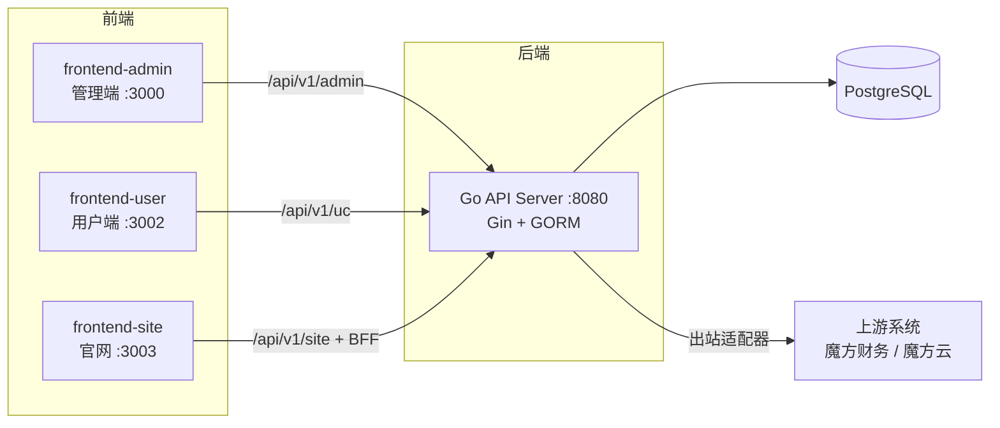

# HostSent

HostSent 是一个云主机管理系统，面向云资源的售卖、管理、监控与售后场景，覆盖从官网门户、商品选购、下单支付，到实例开通、生命周期管理、财务结算与售后的完整业务闭环。

## 架构总览



## 功能特性

- **门户与商城**：Nuxt 官网（商品展示 / 公告 / 帮助 / 新闻）、用户端商城与购物车、多周期定价与限时折扣
- **订单与支付**：订单状态机、支付中心（渠道 / 支付单 / 退款 / 代付 / 回调）、钱包充值与提现、发票、积分
- **实例管理**：开通履约队列、生命周期推进器（续费 / 到期 / 宽限 / 退款处置）、管理端实例运维台、同步中心（商品 / 价格分域同步）
- **会员与等级**：用户会员阶梯、代理等级与折扣方案、多级定价、推荐返利
- **财务域**：账单（多来源拆分）、成本管理（成本项 / 上游成本）、财务设置与统计
- **安全与合规**：RBAC 权限、风控引擎（设备指纹）、验证码（native / 极验 / 腾讯 / 阿里 / 顶象）、实名认证（支付宝 / 人工复核）、OAuth 第三方登录（QQ / 微信 / 支付宝）、用户注销闭环
- **内容与通知**：内容中心（文章 / 分类 / 友链，定时发布 + 前台按需再验证）、通知中心（多短信渠道 + 邮件）、日志中心（查询 / 导出 / 清理策略 / 上游调用记录）
- **组织与协作**：员工与部门、销售业绩（客户 / 佣金 / 提现）、工单协作（附件 / 评价）
- **上游对接**：魔方财务（zjmf）与魔方云（dcimcloud）适配器、规格原子化（specatom）、价格矩阵、选项目录与选项映射、凭证加密落库

## 技术栈

| 层 | 技术 |
| --- | --- |
| 后端 | Go 1.25 · Gin · GORM · PostgreSQL |
| 管理端 | Vue 3 · TypeScript · TDesign Vue Next · Vite（`:3000`） |
| 用户端 | Vue 3 · TypeScript · TDesign Vue Next · Vite（`:3002`） |
| 官网 | Nuxt 3（`:3003`） |
| 基础设施 | Docker Compose · GitHub Actions CI · OpenAPI 3 |

## 项目结构

```text
hostsent/
├── backend/                  # Go 后端服务（端口 8080）
│   ├── cmd/server/           # 入口
│   ├── internal/
│   │   ├── modules/
│   │   │   ├── admin/        # 管理端模块（见下「模块地图」）
│   │   │   ├── uc/           # 用户端模块（见下「模块地图」）
│   │   │   └── site/         # 官网开放接口
│   │   ├── server/           # 路由注册与模块装配
│   │   └── pkg/              # upstream / payment / oauth / captcha / notifier ...
│   ├── configs/              # config.yaml（config.example.yaml 为模板，不入库）
│   ├── migrations/           # 迁移与数据演进记录（见下文「数据库迁移」）
│   └── docs/openapi.yaml     # 生成的 OpenAPI 文档（勿手改）
├── frontend-admin/           # 管理端（Vite + TDesign，:3000）
├── frontend-user/            # 用户端（Vite + TDesign，:3002）
├── frontend-site/            # 官网（Nuxt，:3003）
├── scripts/                  # start-frontends.sh 等脚本，日志在 scripts/logs/
├── docs/                     # 架构文档、实施计划（不入库）
└── .github/workflows/ci.yml  # CI
```

## 模块地图

后端每个模块遵循统一分层：`dto`（传输对象）→ `model`（GORM 模型）→ `repository`（数据访问）→ `service`（业务逻辑）→ `handler`（HTTP 接口），并在 `internal/server/` 完成装配。

| 域 | 模块 |
| --- | --- |
| `admin/` 管理端 | `user`（账号/等级/实名）· `product`（商品目录/SKU/限时折扣）· `resource`（供应商/同步中心）· `finance`（账单/充值/提现/成本/积分/返利/价格矩阵）· `instance`（实例/生命周期）· `order` · `system`（支付/通知/内容/日志中心/员工/验证码）· `sales`（业绩/佣金）· `manager`（部门/员工）· `menu` · `ticket` · `logcenter` |
| `uc/` 用户端 | `auth` · `member` · `product`（商城）· `order` · `payment`（收银台）· `finance`（钱包/账单）· `instance`（云主机）· `oauth` · `point` · `referral` · `captcha` · `menu` |
| `site/` 官网 | 商品 / 公告 / 帮助 / 新闻等开放接口（Nuxt BFF 同源代理） |

`internal/pkg/` 关键能力包：

| 包 | 职责 |
| --- | --- |
| `upstream` | 上游适配器（mofangfinance / mofangyun）、ProviderManager 工厂、能力分发 |
| `payment` / `alipay` | 支付契约层与渠道实现 |
| `credentials` / `crypto` / `mask` | 凭证 AES-256-GCM 加密、脱敏 |
| `transport` | 出站 HTTP 统一封装（超时 / 重试 / 记录） |
| `specatom` / `pricing` / `billingcycle` | 规格原子化、多级定价、计费周期 |
| `oauth` / `realname` / `captcha` / `passwordpolicy` | 第三方登录 / 实名 / 验证码 / 密码策略 |
| `notifier` / `publishsched` / `revalidate` / `jobrun` | 多渠道通知、定时发布、前台按需再验证、任务执行记录 |
| `cache` / `storage` / `observability` / `logger` | 缓存（local/redis）、对象存储、可观测性、日志 |

## 快速开始

### 环境要求

- Go >= 1.25、Node.js >= 20、PostgreSQL 14+
- 生成 OpenAPI 需要 Python 3

### 后端

```bash
# 1. 准备配置
cp backend/configs/config.example.yaml backend/configs/config.yaml
#    编辑数据库 / JWT / 上游等配置（config.yaml 不入库）

# 2. 启动 PostgreSQL（或使用现成实例）
cd backend && docker compose up -d

# 3. 启动服务
cd backend && go run ./cmd/server   # 监听 :8080
```

`config.yaml` 主要配置段：

| 段 | 说明 |
| --- | --- |
| `app` | 服务端口等基础项 |
| `auth` | JWT 密钥、登录安全（失败锁定）等 |
| `database` / `redis` | PostgreSQL 连接、Redis 连接 |
| `pricing` | 定价相关参数 |
| `revalidate` | 官网缓存主动失效接口的共享 token（与官网 `NUXT_INTERNAL_TOKEN` 一致） |

### 前端（一键启动三个前端）

```bash
./scripts/start-frontends.sh          # 启动 admin(3000) / user(3002) / site(3003)
./scripts/start-frontends.sh stop     # 停止
./scripts/start-frontends.sh restart  # 重启
```

脚本会自动释放端口、缺 `node_modules` 时先 `npm install`，日志写入 `scripts/logs/`。开发代理统一指向本地后端 `http://127.0.0.1:8080`。

| 应用 | 地址 | 环境变量模板 |
| --- | --- | --- |
| 管理端 frontend-admin | http://localhost:3000 | `.env.example`（`VITE_USER_BASE_URL` 用户端地址） |
| 用户端 frontend-user | http://localhost:3002 | `.env.example`（`VITE_API_URL`） |
| 官网 frontend-site | http://localhost:3003 | `.env.example`（`NUXT_PUBLIC_*`、`NUXT_INTERNAL_TOKEN`） |

## 数据库迁移

- 表结构演进由 GORM `AutoMigrate` 自动补列（见 `internal/pkg/db/db.go`），服务启动即生效。
- `backend/migrations/*.sql` 为迁移记录与数据演进说明，**不设独立迁移 runner**；需要数据回填时通过 `db.go` 中的 Go seed 完成，`*_live_verify_test.go` 会对齐校验。

## API 文档与 OpenAPI 生成

接口文档为 `backend/docs/openapi.yaml`，由路由注册生成，**不要手工编辑**；改完路由后在 `backend/` 下执行：

```bash
python3 scripts/gen_openapi.py
```

生成器扫描 `internal/server/router.go` 与 `internal/server/assembly_oauth.go`，推导路径、tag、摘要、鉴权方式与权限码；需要补充描述 / 参数 / 请求体时改 `backend/docs/openapi.template.yaml` 或 `backend/scripts/openapi_overrides.json`。有路由漏登记时生成会失败并列出路径，而不是让它静默从文档里消失。

## 测试

```bash
cd backend
go test -count=1 ./...                                   # 全量单测
go test -tags live -run TestXxx ./internal/pkg/db/...    # live 测试（build tag: live）
```

部分 live 测试（真机联调）通过环境变量开启，未设置时自动跳过，例如魔方财务：`LIVE_ZJMF=1`、`ZJMF_USER`、`ZJMF_PASS`。

前端类型检查：

```bash
cd frontend-admin && npx vue-tsc --noEmit
cd frontend-user  && npx vue-tsc --noEmit
```

## 工具命令

除生产入口 `cmd/server` 外，`backend/cmd/` 还提供两个辅助工具：

| 入口 | 用途 |
| --- | --- |
| `go run ./cmd/openapp` | 开放平台应用管理 CLI：open_apps 的建应用 / 启停 / 重置密钥 / 回调与 IP 白名单设置（密钥经 AES 加密落库，明文仅创建时打印一次） |
| `go run ./cmd/ucgatewaymock` | 支付宝开放平台模拟器，供 `scripts/e2e_user_closure.py` 等用户端闭环 E2E 联调使用，无需真实支付宝环境 |

## CI

`.github/workflows/ci.yml` 包含三个 job，全部通过才算绿：

1. **Backend (build + vet + test)**：`go build` → `go vet` → `gofmt` 格式检查（未格式化即失败）→ `go test -count=1 ./...`
2. **Admin Frontend (vue-tsc + build)**
3. **User Frontend (vue-tsc + build)**

提交前请确保 `gofmt -l` 为空、两端 `vue-tsc` 通过，避免 CI 变红。

## 上游对接

系统通过适配器模式对接上游财务 / 云主机系统，适配器位于 `backend/internal/pkg/upstream/`：

- **mofangfinance**（魔方财务 / 智简魔方）：`createApi` 注册凭证、`inputProduct` 导入商品、价格行无损承载与折扣换算
- **mofangyun**（魔方云 / dcimcloud）：服务器接入、能力分发与选项目录取值映射

统一约定：

- 适配器实现 `upstream.Provider` 接口，经 `ProviderManager` 按类型工厂化创建，支持同类型多供应商
- 凭证（api_key / api_secret）经 AES-256-GCM 加密落库，对外脱敏展示
- 出站调用统一走 `pkg/transport`，调用记录进入日志中心的上游调用台账
- 真机联调测试以 build tag `live` 隔离，凭证走环境变量，不硬编码

对接参考文档见 `docs/魔方云对接魔方财务.html` 与 `docs/实施计划/`（本地文档，不入库）。

## 文档

- 架构与实施计划：`docs/实施计划/`
- 接口文档：`backend/docs/openapi.yaml`
